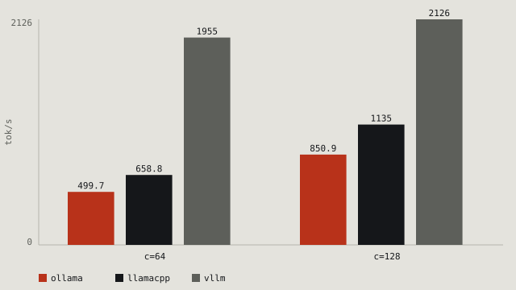
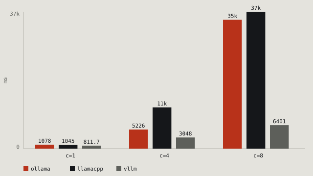

# llm-serving-bench

One model, one GPU, the same 200 prompts. Three serving stacks, nine charts.

[](https://github.com/Dilmurod777/llm-serving-bench/actions/workflows/tests.yml)

## What this is

An 8B model, a 24 GB GPU, and three serving stacks (Ollama, llama.cpp and vLLM) all
running inside one WSL2 image. The driver, the VRAM accounting and the prompt set are
identical across all three, which is the point of the setup. The useful question isn't
which one wins. It's where each stops being the right choice, in tokens, seconds and
dollars.


With one request in flight they land within 8% of each other (106–114 tok/s). An 8B
model on one GPU costs what it costs. Batching is where they separate: at 32 concurrent
requests vLLM serves **1646 tok/s** ($0.06 per 1M output tokens), llama.cpp 967
($0.10) and Ollama 747 ($0.13). Same weights, same card, a 2.2× spread.

| engine | concurrency | output tok/s | p50 ms | p95 ms | peak VRAM MiB | $/1M output tokens |
|---|---|---|---|---|---|---|
| ollama | 1 | 106.07 | 2360.9 | 2380.8 | 13448 | 0.92 |
| llamacpp | 1 | 109.90 | 2302.1 | 2329.0 | 13285 | 0.88 |
| vllm | 1 | 114.27 | 2214.9 | 2230.4 | 16830 | 0.85 |
| ollama | 8 | 194.82 | 10453.3 | 13474.8 | 13397 | 0.50 |
| llamacpp | 8 | 214.02 | 9847.1 | 12775.0 | 13291 | 0.45 |
| vllm | 8 | 774.75 | 2508.0 | 2594.5 | 16994 | 0.13 |
| ollama | 32 | 747.46 | 10008.8 | 10358.2 | 13397 | 0.13 |
| llamacpp | 32 | 966.60 | 7540.4 | 7867.0 | 13287 | 0.10 |
| vllm | 32 | 1645.61 | 4205.9 | 4553.3 | 17172 | 0.06 |

Regenerate the tables and charts with `make chart` (or `python -m bench.plot`).
Versions, request contract and caveats live in [What this measures](#what-this-measures).

## Speed per user


The table above is the server's total throughput. This one is what a single user gets:
the median of each request's own `tokens ÷ latency`. Queueing and batch scheduling can't
hide here the way they can inside a total.

| engine | concurrency | tok/s per user | output tok/s in total |
|---|---|---|---|
| ollama | 1 | 108.4 | 106.07 |
| llamacpp | 1 | 111.2 | 109.90 |
| vllm | 1 | 115.6 | 114.27 |
| ollama | 8 | 23.8 | 194.82 |
| llamacpp | 8 | 26.0 | 214.02 |
| vllm | 8 | 102.0 | 774.75 |
| ollama | 32 | 25.6 | 747.46 |
| llamacpp | 32 | 33.9 | 966.60 |
| vllm | 32 | 60.8 | 1645.61 |

This is the harsher view. With eight concurrent users vLLM still gives each one
**102 tok/s**, which is readable speed, while both GGUF engines drop to 24–26, roughly a
quarter of their single-stream rate. At 32 users vLLM halves to 61 and the other two sit
at 26–34.

Both GGUF engines are also *slower per user at 8 than at 32* (23.8 against 25.6 on
Ollama, 26.0 against 33.9 on llama.cpp). Queueing can't explain that, since fewer users
should mean faster streams. What happens is that their backends fill the batch badly at
eight slots, so the aggregate curve shows a dip at 8 instead of a step.

## Time to first token


Same prompt set, one token per request. That measures prefill plus a single decode step,
which is exactly what a streaming client waits through before the first character
appears.

| engine | concurrency | p50 ms | p95 ms |
|---|---|---|---|
| ollama | 1 | 47.0 | 63.7 |
| llamacpp | 1 | 42.1 | 57.7 |
| vllm | 1 | 32.1 | 47.1 |
| ollama | 8 | 362.1 | 459.0 |
| llamacpp | 8 | 352.2 | 464.9 |
| vllm | 8 | 203.0 | 255.9 |
| ollama | 32 | 1258.0 | 1588.9 |
| llamacpp | 32 | 1215.4 | 1566.6 |
| vllm | 32 | 824.5 | 1031.8 |

Unloaded, all three sit in the same 32–47 ms band. vLLM is quickest there because its
scheduler admits the whole batch in one step. Under load the GGUF engines queue behind
their slots (1.22–1.26 s at 32) while vLLM's continuous batching holds the wait at
0.82 s. A 256-token benchmark hides all of this. The first token is what a user actually
feels.

## Power and energy


Board power comes from `nvidia-smi`, averaged over each sweep. The Windows desktop's own
draw is included, so read the deltas between engines rather than the absolute watts.

| engine | concurrency | avg W | J/1M output tokens |
|---|---|---|---|
| ollama | 1 | 134.1 | 1,264,260 |
| llamacpp | 1 | 137.3 | 1,249,352 |
| vllm | 1 | 130.7 | 1,143,832 |
| ollama | 8 | 127.1 | 652,409 |
| llamacpp | 8 | 129.8 | 606,484 |
| vllm | 8 | 127.7 | 164,828 |
| ollama | 32 | 87.1 | 116,528 |
| llamacpp | 32 | 105.9 | 109,560 |
| vllm | 32 | 139.8 | 84,953 |

From one stream to 32 concurrent requests, energy per token falls about 13× on vLLM and
11× on the GGUF engines. Note which way the watts move at the top end. vLLM draws the
*most* power at 32 slots (140 W) and still uses the least energy per token, since it
finishes 2.2× more tokens in the same second. A watt is a power bill. Joules per token
are the bill for the work.


## FP8 vs AWQ


| engine | concurrency | output tok/s | p50 ms | p95 ms | peak VRAM MiB | $/1M output tokens |
|---|---|---|---|---|---|---|
| vllm (AWQ) | 1 | 114.27 | 2214.9 | 2230.4 | 16830 | 0.85 |
| vllm-fp8 | 1 | 73.85 | 3440.9 | 3456.0 | 16739 | 1.32 |
| vllm (AWQ) | 8 | 774.75 | 2508.0 | 2594.5 | 16994 | 0.13 |
| vllm-fp8 | 8 | 534.26 | 3710.1 | 3781.9 | 16882 | 0.18 |
| vllm (AWQ) | 32 | 1645.61 | 4205.9 | 4553.3 | 17172 | 0.06 |
| vllm-fp8 | 32 | 1451.85 | 4712.6 | 4991.0 | 17118 | 0.07 |

FP8 loses everywhere: −35% throughput at one stream, −31% at 8 and −12% at 32, at $1.32
per million tokens against $0.85. The table shows both reasons. FP8 weights take 9.5 GB
against the 4-bit AWQ's 5.5 GB, so every token reads *more* bytes. And the fast FP8 path
on this card is DeepGEMM, which wants a CUDA toolkit this machine doesn't have; what ran
was vLLM's Cutlass block-scaled fallback. FP8 pays off in a data centre, on Hopper or
Blackwell with the full kernel set and against an unquantised BF16 baseline. Against AWQ
on a 24 GB laptop without the toolkit, it doesn't.

## Speculative decoding


| engine | concurrency | output tok/s | p50 ms | p95 ms | peak VRAM MiB | $/1M output tokens |
|---|---|---|---|---|---|---|
| vllm | 1 | 114.27 | 2214.9 | 2230.4 | 16830 | 0.85 |
| vllm-spec | 1 | 157.31 | 1488.9 | 2369.4 | 16086 | 0.62 |
| vllm | 8 | 774.75 | 2508.0 | 2594.5 | 16994 | 0.13 |
| vllm-spec | 8 | 980.11 | 1861.4 | 2896.0 | 16082 | 0.10 |
| vllm | 32 | 1645.61 | 4205.9 | 4553.3 | 17172 | 0.06 |
| vllm-spec | 32 | 1674.47 | 4141.0 | 6487.9 | 16348 | 0.06 |

A 0.6B draft model proposes 5 tokens per step and the 8B target checks them in one
forward pass. That buys **+38% at one stream** and **+27% at 8**, then nothing: **+1.6% at
32**. vLLM's own metrics say why. At one stream the draft had 76.6% of its proposals
accepted, mean acceptance length 4.8 out of 5, and that only pays while the GPU has spare
compute for the draft. Once 32 sequences saturate the batch the verifier is the
bottleneck, and the draft becomes nearly free work that no longer buys tokens. It widens
the tail too: p95 at 32 slots is 6.49 s against 4.66 s, since acceptance varies by prompt
and a rejected draft throws the step away. VRAM doesn't move (the 1.5 GB draft fits
inside the same reservation), so what you trade is latency tail for throughput, and only
at low concurrency.

## Short answers


The same 200 prompts, capped at **32 output tokens** instead of 256. That's the shape of
an assistant reply, not a page of text.

| engine | concurrency | output tok/s | p50 ms | $/1M output tokens |
|---|---|---|---|---|
| ollama | 1 | 84.04 | 333.4 | 1.16 |
| llamacpp | 1 | 92.32 | 320.8 | 1.05 |
| vllm | 1 | 98.97 | 297.8 | 0.98 |
| ollama | 8 | 151.37 | 1392.9 | 0.64 |
| llamacpp | 8 | 171.19 | 1223.7 | 0.57 |
| vllm | 8 | 438.46 | 449.6 | 0.22 |
| ollama | 32 | 389.97 | 1991.8 | 0.25 |
| llamacpp | 32 | 443.14 | 1629.2 | 0.22 |
| vllm | 32 | 630.11 | 1091.7 | 0.15 |

Short answers change two things. **Cost per token goes up.** Ollama at one stream moves
from $0.92 to $1.16 per million tokens, because the ~120-token prompt and the
per-request overhead now get spread over 32 tokens instead of 256. And **vLLM's lead
narrows.** At 32 users it is 1.4× llama.cpp here (630 against 443 tok/s) rather than the
1.7× of the 256-token sweep. Its advantage is biggest when there is more decode work to
batch, so the 256-token numbers already flatter it.

## Beyond 32 users



| engine | concurrency | output tok/s | p50 ms | p95 ms | peak VRAM MiB | $/1M output tokens |
|---|---|---|---|---|---|---|
| ollama | 64 | 499.68 | 31535.0 | 39065.5 | 19062 | 0.19 |
| llamacpp | 64 | 658.78 | 22492.6 | 28728.2 | 18194 | 0.15 |
| vllm | 64 | 1954.89 | 6773.7 | 7361.7 | 17037 | 0.05 |
| ollama | 128 | 850.93 | 32085.1 | 34546.7 | 18274 | 0.11 |
| llamacpp | 128 | 1134.79 | 20649.4 | 23127.6 | 18035 | 0.09 |
| vllm | 128 | 2126.16 | 11749.0 | 13530.1 | 17344 | 0.05 |

At 128 concurrent requests none of the three saturates the card. Every engine is still
adding throughput, and vLLM's lead grows from 1.7× at 32 users to 1.9× at 128. Cost per
token keeps falling for the same reason.

What breaks first is the user, not the GPU. At 128 concurrent requests each stream gets
8 tok/s on Ollama, 12 on llama.cpp and 22 on vLLM, so a 256-token answer takes 32, 21 and
12 seconds. Past 32 users, aggregate throughput and interactivity part company
completely, and only one of those three numbers describes what a user actually
experiences.

This profile reshapes the engines for the load: 128 slots of 512-token context each
(vLLM also gets a 512-token maximum model length), so the KV cache fits. The numbers
compare engines at that shape, not with the 1,024-token baseline.

## Long prompts



| engine | concurrency | TTFT p50 ms | TTFT p95 ms |
|---|---|---|---|
| ollama | 1 | 872.0 | 1078.0 |
| llamacpp | 1 | 879.8 | 1044.9 |
| vllm | 1 | 641.6 | 811.7 |
| ollama | 4 | 1321.3 | 5225.6 |
| llamacpp | 4 | 1729.5 | 11287.0 |
| vllm | 4 | 2364.5 | 3047.6 |
| ollama | 8 | 1669.1 | 35242.7 |
| llamacpp | 8 | 1688.5 | 37446.7 |
| vllm | 8 | 4595.4 | 6400.6 |

Fifty prompts of ~15,000 characters, about 3.6k tokens, one token per request. So this
is prefill and nothing else. Each engine gets 8 slots of 8,192 tokens of context, enough
for a 4k prompt plus a reply. The chart plots the 95th percentile, where the engines
actually separate. The table carries both.

With one user, vLLM is fastest by 27% (642 ms against 872 and 880), which is what you'd
expect from its prefill kernels. Under load the shapes invert. vLLM's median rises
fourfold to 4.6 s because it interleaves prompt processing with decodes. The GGUF engines
hold a median near 1.7 s, so most requests come back quickly, but their p95 reaches 35
and 37 seconds, twenty times their own median, because llama.cpp processes a 4k prompt as
one indivisible step: a request that lands behind it waits for the whole thing.

Which engine you want depends on which number you're promising. For long documents under
concurrency, vLLM is slower for the typical request and far more predictable (p95/p50 =
1.4). The GGUF engines are quick for most requests and hand a few users a half-minute
stall (p95/p50 = 21).


## What this measures

This is the baseline profile, the one the first table reports. All three stacks serve
the same model on one RTX 5090 Laptop (24 GB), inside WSL2 Ubuntu 24.04:

| engine | version | how it serves |
|---|---|---|
| Ollama | 0.40.8 | `ollama serve`, 32 slots × 1024 tokens of context, model built from the GGUF below |
| llama.cpp | b11819, CUDA 13.4 prebuilt | `llama-server -c 32768 --parallel 32 -ngl 99` |
| vLLM | 0.32.0 (torch 2.13.0+cu130) | `vllm serve Qwen/Qwen3-8B-AWQ --max-model-len 1024 --max-num-seqs 32 --max-num-batched-tokens 8192 --gpu-memory-utilization 0.55` |

The extra profiles restart the engines with different slot counts and context: 512
tokens per slot at 64 and 128 concurrent users, 8192 per slot for the long-prompt run.
Each section says which profile it reports.

Two more vLLM configurations reuse the same server. `vllm-fp8` serves the FP8 weights
instead of AWQ, and `vllm-spec` adds a 0.6B draft model (`--speculative-config`, 5
speculative tokens). Both are opt-in and stay out of the baseline sweep.

Every request is a **raw completion**: no chat template, `temperature=0`, seed 0. All of
them run against the same 200-passage prompt set (`data/prompts.jsonl`, sha256 pinned in
`bench/prompts.py`). The baseline caps answers at 256 tokens, the TTFT sweeps at 1 and
the short-answer sweep at 32. Prompt text comes from the FAA *AC 43.13-1B* (US government
work, public domain): 200 passages of 150–400 characters, sampled deterministically. The
long-prompt profile uses `data/prompts_long.jsonl` instead, 50 passages of ~15,000
characters, also sha256-pinned.

Each baseline run is 200 requests at concurrency 1, 8 and 32. Before an engine starts
the GPU has to be idle, at least 14 GB free, so none of our models is resident. Engines
are stopped between runs, so two stacks are never resident at once. VRAM and board power
are sampled every 0.5 s during a sweep, and VRAM is the absolute `nvidia-smi` peak.

Every result written by this version of `bench` records the engine version, the GPU and
driver, the UTC date, the sha256 of the prompt file it ran, and the model, slot count and
context it ran with. Any checked-in number can be traced back to a build.

## Models

| model | size | licence | source |
|---|---|---|---|
| `Qwen3-8B-Q4_K_M.gguf` (Ollama, llama.cpp) | 4.7 GB | Apache-2.0 | [Qwen/Qwen3-8B-GGUF](https://huggingface.co/Qwen/Qwen3-8B-GGUF) |
| `Qwen/Qwen3-8B-AWQ` (vLLM, spec target) | 5.5 GB | Apache-2.0 | [Qwen/Qwen3-8B-AWQ](https://huggingface.co/Qwen/Qwen3-8B-AWQ) |
| `Qwen/Qwen3-8B-FP8` (vLLM, FP8 run) | 9.5 GB | Apache-2.0 | [Qwen/Qwen3-8B-FP8](https://huggingface.co/Qwen/Qwen3-8B-FP8) |
| `Qwen/Qwen3-0.6B` (draft for speculative decoding) | 1.5 GB | Apache-2.0 | [Qwen/Qwen3-0.6B](https://huggingface.co/Qwen/Qwen3-0.6B) |

The quantisation differs on purpose. vLLM's fast path on sm_120 is AWQ/Marlin, or FP8,
while the two GGUF engines share the same 4-bit bytes. So the vLLM row is *not* a pure
serving-stack comparison. It is "vLLM at its best quantisation" against "llama.cpp and
Ollama at a 4-bit GGUF", and it is written here rather than hidden.

Serving one GGUF in all three was the first thing tried, and on this stack it can't be
done. vLLM 0.32.0 ships no GGUF loader: no `quantization/gguf.py`, no
`model_loader/gguf_loader.py`, no GGUF entry in `LoadFormat` or `--quantization`.
Removing that confound would take a second, older vLLM install or a plugin. It stays a
documented limitation, not a silent one.

Weights never enter this repo. `make models` downloads and verifies them into `models/`,
which is git-ignored.

## Cost

```
$ / 1M output tokens = GPU price per hour / (output tokens per second × 3600) × 1e6
```

with `GPU_PRICE_PER_HOUR = 0.35` in `bench/config.py` (a rented 5090). That is the only
number in the tables that is an assumption rather than a measurement, and it sits in the
source so you can put your own price there.

## Reproduce

Three commands, on a machine with an RTX 5090 and WSL2 Ubuntu 24.04:

```bash
git clone https://github.com/Dilmurod777/llm-serving-bench && cd llm-serving-bench
make install models ollama-model
make bench
```

`make bench` runs `scripts/run_all.sh`. It starts one engine, sweeps concurrency 1/8/32,
repeats the sweep with one-token requests for TTFT, stops the engine and moves to the
next, then renders the charts and prints the Markdown tables. The two extra vLLM
configurations are opt-in:

```bash
ENGINES=ollama,llamacpp,vllm,vllm-fp8,vllm-spec make bench
```

The 32-token "short answers" sweep is opt-in too. `SHORT=1 make bench` runs it after the
256-token sweeps, and `SHORT=only` runs nothing else. Both write to `results/short/`.

The other two profiles reconfigure the engines rather than adding a pass, so each one
runs alone. `PROFILE=wide make bench` covers 64 and 128 concurrent with 512-token context
per slot, into `results/wide/`. `PROFILE=long make bench` runs 50 prompts of ~15k
characters with 8192-token context per slot at 1/4/8 concurrent, into `results/long/`.

`make test` runs the 44 unit tests: summary, energy and per-user math, the three HTTP
adapters against mocked servers, the VRAM gate, the sweep runner, prompt-set integrity,
the charts, and the comparison guards.

To check your own machine's number against these, see
[Reproduce on your machine](#reproduce-on-your-machine).

## Reproduce on your machine

One CUDA GPU with at least 16 GB free, WSL2 Ubuntu 24.04, engines from `make install`
and weights from `make models`. The idle gate refuses to start a sweep with less than
14 GB free, so stop anything else that holds the card — an embedding model is the usual
culprit.

Approximate wall times on this laptop: baseline ≈ 40 min, `SHORT=only` ≈ 10 min,
`PROFILE=wide` ≈ 20 min, `PROFILE=long` ≈ 15 min, `make verify` ≈ 8 min.

Three commands to a comparable row:

```bash
git clone https://github.com/Dilmurod777/llm-serving-bench && cd llm-serving-bench
make install models ollama-model
make verify
```

`make verify` runs one 256-token sweep at concurrency 1 into `results/local/`, then
compares it with the committed `results/ollama-c1.json`. Use `make verify ENGINE=vllm`
for another engine, and add `MODEL=<id>` to point Ollama or vLLM at another model. Ollama
needs that model created first; llama.cpp is file-driven, so a `MODEL` there is reported
and ignored.

The comparison is offline: `python -m bench.compare A B` reads JSON files only. The first
argument is the reference, the second is yours, and the delta is `(yours − reference) /
reference`, so positive throughput means faster and positive latency means slower. Gated
metrics are total throughput, per-user throughput, p50 and p95. The band is 25% and
advisory; `--strict` turns any `out`, `incomparable` or `missing` row into exit 1. VRAM,
power, energy and cost are shown but never gated. The eighteen baseline rows were
annotated with the model, slot count and context they ran under; their measurements are
unchanged. The twelve committed `vllm-fp8` and `vllm-spec` files predate the record and
stay without meta, so they are reported as `incomparable: no meta` rather than guessed at.

### What differs legitimately

GPU class, driver, desktop VRAM and clocks. A desktop 4090 and a laptop 5090 are not the
same machine; the desktop compositor also holds several GB. A 25% band covers that, and
`avg_power_w` is printed next to the delta so a throttled run is visible instead of being
mistaken for a slow engine.

### When your number is wrong

| symptom | cause | fix |
|---|---|---|
| 10× slow, no CUDA lines in the llama.cpp log | the CUDA backend was not loaded; the runtime libraries are not beside the binary | put `libcudart` and `libcublas` next to `llama-server` |
| `attempted to allocate 135168.00 MB` | Ollama multiplies context by parallel slots | set `OLLAMA_CONTEXT_LENGTH` per slot, not as a total |
| GPU busy before the sweep | another process holds VRAM, usually an embedding model | stop it; the gate wants 14 GB free |
| `Could not find nvcc` or a DeepGEMM assertion | vLLM wants a CUDA toolkit for a JIT kernel | `VLLM_USE_FLASHINFER_SAMPLER=0`, `VLLM_USE_DEEP_GEMM=0` |
| 30–50% off with everything healthy | the laptop is throttling | rerun cool and compare `avg_power_w` |

If the row says `incomparable`, read the reason before the delta: a different prompt set,
`max_tokens`, model, slot count or context is a different measurement, and the tool will
not subtract them.

## Layout

```
bench/       config, engine adapters, sweep runner, summary math, VRAM sampler, chart,
             compare.py (offline delta tool)
data/        200 fixed prompts, plus 50 long ones (both sha256-pinned)
scripts/     install_engines.sh, fetch_models.sh, run_all.sh, make_prompts*, Modelfile
results/     one json + jsonl per (engine, concurrency); short/, wide/, long/ for profiles
docs/        chart.svg, perstream.svg, ttft.svg, energy.svg, fp8.svg, spec.svg,
             short.svg, wide.svg, ttft-long.svg
tests/       44 pytest tests
```

## Caveats

- A laptop 5090, not a datacentre card. Clocks throttle, and the Windows desktop holds
  ~7 GB of the card.
- VRAM here compares each engine's own memory **policy** (Ollama's 32k-context
  reservation, llama.cpp's per-slot cache, vLLM's utilisation cap), not just the weights.
- Token counts are each server's own accounting (`eval_count`,
  `timings.predicted_n`, `usage.completion_tokens`).
- Numbers come from one machine, and repeated runs differ. Two independent full sweeps
  of the three baseline engines agree within 4% everywhere except Ollama at concurrency
  1 (12%), the least stable point, where one prompt hits Ollama's repeat guard. The FP8
  and speculative-decoding variants were measured in a separate session; their vLLM
  baseline column shows the main table's numbers so the comparison stays apples to
  apples.
- The total-throughput curve isn't monotonic for the GGUF engines. [Speed per
  user](#speed-per-user) shows that this is batch fill, not queueing.
- vLLM runs with `VLLM_USE_FLASHINFER_SAMPLER=0`. The flashinfer sampler JIT-compiles C++
  on first use and wants a full CUDA toolkit, while the torch sampler doesn't. That's the
  sampling kernel, not the model path, and at `temperature=0` it costs nothing
  measurable.
- The FP8 run sets `VLLM_USE_DEEP_GEMM=0` as well. vLLM's first choice for block-scaled
  FP8 is DeepGEMM, and its bundled JIT also wants a CUDA toolkit; the Cutlass FP8 kernel
  it falls back to needs none. The FP8 numbers here are Cutlass.
