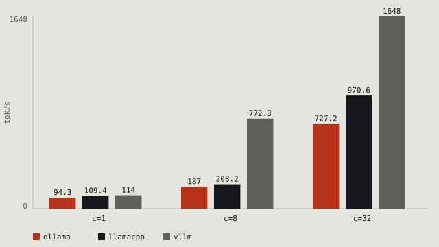
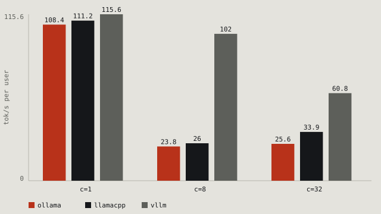
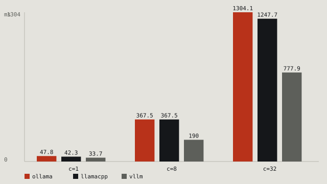
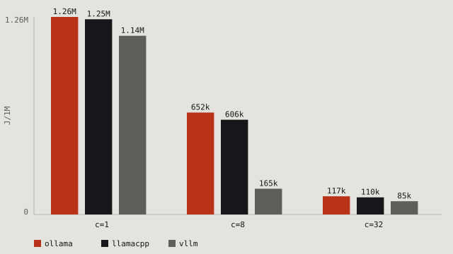
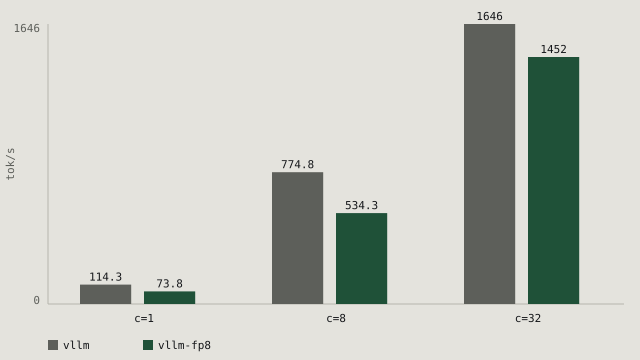
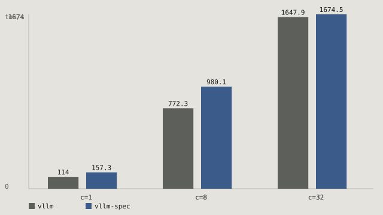
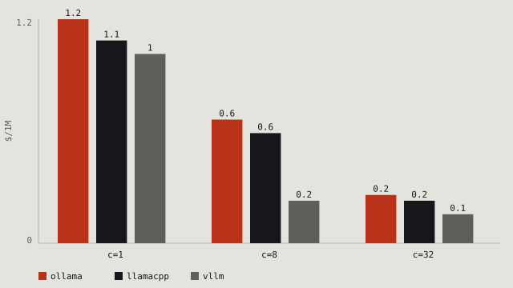

# llm-serving-bench

Same model, same GPU, same 200 prompts. Three serving stacks, seven charts.

## What this is

Three ways to serve one 8B model on a single 24 GB GPU — Ollama, llama.cpp and
vLLM — measured on the same 200 prompts at the same concurrencies, inside one WSL2
image so the driver and the VRAM accounting are identical for all three. It reports
throughput, p50/p95 latency, time to first token, speed per user, VRAM, board power
and cost per million output tokens, plus FP8, speculative decoding and short
answers. Setup, versions and caveats: [What this measures](#what-this-measures).



At single-stream all three are within 8% of each other (106–114 tok/s): one 8B model
on one GPU costs what it costs. Batching is where they part. At 32 concurrent
requests vLLM serves **1646 tok/s** ($0.06 per 1M output tokens), llama.cpp 967
($0.10) and Ollama 747 ($0.13) — a 2.2× spread for the same weights on the same
card.

| engine | concurrency | output tok/s | p50 ms | p95 ms | peak VRAM MiB | $/1M output tokens |
|---|---|---|---|---|---|---|
| ollama | 1 | 106.07 | 2360.9 | 2380.8 | 13448 | 0.92 |
| llamacpp | 1 | 109.90 | 2302.1 | 2329.0 | 13285 | 0.88 |
| vllm | 1 | 114.27 | 2214.9 | 2230.4 | 16830 | 0.85 |
| ollama | 8 | 194.82 | 10453.3 | 13474.8 | 13397 | 0.50 |
| llamacpp | 8 | 214.02 | 9847.1 | 12775.0 | 13291 | 0.45 |
| vllm | 8 | 774.75 | 2508.0 | 2594.5 | 16994 | 0.13 |
| ollama | 32 | 747.46 | 10008.8 | 10358.2 | 13397 | 0.13 |
| llamacpp | 32 | 966.60 | 7540.4 | 7867.0 | 13287 | 0.10 |
| vllm | 32 | 1645.61 | 4205.9 | 4553.3 | 17172 | 0.06 |

Regenerate these tables and the charts with `make chart` (or `python -m bench.plot`).

## Speed per user



The table above is the server's total throughput. This one is what one user gets:
the median of each request's own `tokens ÷ latency`, so queueing and batch
scheduling show up instead of hiding in the total.

| engine | concurrency | tok/s per user | output tok/s in total |
|---|---|---|---|
| ollama | 1 | 108.4 | 106.07 |
| llamacpp | 1 | 111.2 | 109.90 |
| vllm | 1 | 115.6 | 114.27 |
| ollama | 8 | 23.8 | 194.82 |
| llamacpp | 8 | 26.0 | 214.02 |
| vllm | 8 | 102.0 | 774.75 |
| ollama | 32 | 25.6 | 747.46 |
| llamacpp | 32 | 33.9 | 966.60 |
| vllm | 32 | 60.8 | 1645.61 |

This is the harsher comparison. At eight concurrent users vLLM still delivers
**102 tok/s per user** — readable speed — while the two GGUF engines drop to 24–26,
about a quarter of their single-stream rate. At 32 users vLLM halves to 61 while
they sit at 26–34.

The GGUF engines are also *slower per user at 8 than at 32* (23.8 vs 25.6 on Ollama,
26.0 vs 33.9 on llama.cpp). Queueing alone cannot do that: fewer users should mean
faster streams. Their backends are filling the batch badly at eight slots, which is
why the aggregate curve looks like a dip at 8 rather than a step.

## Time to first token



Same prompt set, one token per request: this is prefill plus a single decode step,
i.e. what a streaming client waits for before any text appears.

| engine | concurrency | p50 ms | p95 ms |
|---|---|---|---|
| ollama | 1 | 47.0 | 63.7 |
| llamacpp | 1 | 42.1 | 57.7 |
| vllm | 1 | 32.1 | 47.1 |
| ollama | 8 | 362.1 | 459.0 |
| llamacpp | 8 | 352.2 | 464.9 |
| vllm | 8 | 203.0 | 255.9 |
| ollama | 32 | 1258.0 | 1588.9 |
| llamacpp | 32 | 1215.4 | 1566.6 |
| vllm | 32 | 824.5 | 1031.8 |

Unloaded, all three are in the same 32–47 ms band; vLLM is fastest because its
scheduler admits the whole batch in one step. Under load the GGUF engines queue
behind their slots (1.22–1.26 s at 32) while vLLM's continuous batching keeps the
wait at 0.82 s. A 256-token benchmark hides this completely — the first token is
what a user actually feels.

## Power and energy



Board power from `nvidia-smi`, averaged over each sweep (desktop draw included, so
read the deltas between engines rather than the absolute watts).

| engine | concurrency | avg W | J/1M output tokens |
|---|---|---|---|
| ollama | 1 | 134.1 | 1,264,260 |
| llamacpp | 1 | 137.3 | 1,249,352 |
| vllm | 1 | 130.7 | 1,143,832 |
| ollama | 8 | 127.1 | 652,409 |
| llamacpp | 8 | 129.8 | 606,484 |
| vllm | 8 | 127.7 | 164,828 |
| ollama | 32 | 87.1 | 116,528 |
| llamacpp | 32 | 105.9 | 109,560 |
| vllm | 32 | 139.8 | 84,953 |

Energy per token falls ~13× from single stream to 32 concurrent on vLLM and ~11× on
the GGUF engines. Note the direction at the top end: vLLM draws the *most* watts at
32 slots (140 W) and still uses the least energy per token, because it finishes 2.2×
more tokens in the same second. Watts are a power bill; joules per token are the bill
for the work.


## FP8 vs AWQ



| engine | concurrency | output tok/s | p50 ms | p95 ms | peak VRAM MiB | $/1M output tokens |
|---|---|---|---|---|---|---|
| vllm (AWQ) | 1 | 114.27 | 2214.9 | 2230.4 | 16830 | 0.85 |
| vllm-fp8 | 1 | 73.85 | 3440.9 | 3456.0 | 16739 | 1.32 |
| vllm (AWQ) | 8 | 774.75 | 2508.0 | 2594.5 | 16994 | 0.13 |
| vllm-fp8 | 8 | 534.26 | 3710.1 | 3781.9 | 16882 | 0.18 |
| vllm (AWQ) | 32 | 1645.61 | 4205.9 | 4553.3 | 17172 | 0.06 |
| vllm-fp8 | 32 | 1451.85 | 4712.6 | 4991.0 | 17118 | 0.07 |

FP8 loses at every point: −35% throughput at one stream, −31% at 8, −12% at 32, and it
costs $1.32 per million tokens against $0.85. Two reasons, both visible in the table.
FP8 weights are 9.5 GB against the 4-bit AWQ's 5.5 GB, so each token reads *more*
bytes, and on this card the fast FP8 path is DeepGEMM — which needs a CUDA toolkit
this machine does not have. What ran is vLLM's Cutlass block-scaled fallback. FP8 is
a data-centre win (Hopper/Blackwell with the full kernel set, and against an
unquantised BF16 baseline); against AWQ on a 24 GB laptop without the toolkit it is
not.

## Speculative decoding



| engine | concurrency | output tok/s | p50 ms | p95 ms | peak VRAM MiB | $/1M output tokens |
|---|---|---|---|---|---|---|
| vllm | 1 | 114.27 | 2214.9 | 2230.4 | 16830 | 0.85 |
| vllm-spec | 1 | 157.31 | 1488.9 | 2369.4 | 16086 | 0.62 |
| vllm | 8 | 774.75 | 2508.0 | 2594.5 | 16994 | 0.13 |
| vllm-spec | 8 | 980.11 | 1861.4 | 2896.0 | 16082 | 0.10 |
| vllm | 32 | 1645.61 | 4205.9 | 4553.3 | 17172 | 0.06 |
| vllm-spec | 32 | 1674.47 | 4141.0 | 6487.9 | 16348 | 0.06 |

A 0.6B draft model proposes 5 tokens per step and the 8B target verifies them in one
forward pass. That is worth **+38% at one stream** and **+27% at 8**, then nothing:
**+1.6% at 32**. The reason is in vLLM's own metrics — the draft accepted 76.6% of
its proposals at one stream, mean acceptance length 4.8 of 5, which only pays while
the GPU has spare compute to run the draft. Once 32 sequences saturate the batch,
the verifier is the bottleneck and the draft is nearly free work that no longer buys
tokens. It also widens the tail: p95 at 32 slots is 6.49 s against 4.66 s, because
acceptance varies per prompt and a rejected draft wastes the step. VRAM is unchanged
(the 1.5 GB draft fits inside the same reservation), so the trade is latency tail for
throughput, and only at low concurrency.

## Short answers



The same 200 prompts, capped at **32 output tokens** instead of 256 — the shape of
an assistant reply rather than a page of text.

| engine | concurrency | output tok/s | p50 ms | $/1M output tokens |
|---|---|---|---|---|
| ollama | 1 | 84.04 | 333.4 | 1.16 |
| llamacpp | 1 | 92.32 | 320.8 | 1.05 |
| vllm | 1 | 98.97 | 297.8 | 0.98 |
| ollama | 8 | 151.37 | 1392.9 | 0.64 |
| llamacpp | 8 | 171.19 | 1223.7 | 0.57 |
| vllm | 8 | 438.46 | 449.6 | 0.22 |
| ollama | 32 | 389.97 | 1991.8 | 0.25 |
| llamacpp | 32 | 443.14 | 1629.2 | 0.22 |
| vllm | 32 | 630.11 | 1091.7 | 0.15 |

Two things change when the answer gets short. **Cost per token rises**: Ollama at one
stream moves from $0.92 to $1.16 per million tokens, because the ~120-token prompt and
the per-request overhead are now amortised over 32 tokens instead of 256. And **vLLM's
lead narrows**: at 32 users it is 1.4× llama.cpp here (630 against 443 tok/s), not the
1.7× of the 256-token sweep. Its advantage is largest when there is more decode work
to batch, so the 256-token numbers already flatter it.

## What this measures

One 8B model served by three stacks on one RTX 5090 Laptop (24 GB), inside WSL2
Ubuntu 24.04 so the kernel, driver and VRAM accounting are identical for all three:

| engine | version | how it serves |
|---|---|---|
| Ollama | 0.40.8 | `ollama serve`, model built from the GGUF below |
| llama.cpp | b11819, CUDA 13.4 prebuilt | `llama-server -c 32768 --parallel 32 -ngl 99` |
| vLLM | 0.32.0 (torch 2.13.0+cu130) | `vllm serve Qwen/Qwen3-8B-AWQ --max-model-len 4096` |

Two more vLLM configurations reuse the same server: `vllm-fp8` serves the FP8
weights instead of AWQ, and `vllm-spec` adds a 0.6B draft model
(`--speculative-config`, 5 speculative tokens). They are opt-in, not part of the
baseline sweep.

Every request is a **raw completion** — no chat template, `temperature=0`,
`max_tokens=256`, seed 0 — against the same 200-passage prompt set
(`data/prompts.jsonl`, sha256 pinned in `bench/prompts.py`). Prompt text comes from
the FAA *AC 43.13-1B* (US government work, public domain): 200 passages of
150–400 characters, sampled deterministically.

Each baseline run is 200 requests at concurrency 1, 8 and 32; every engine also gets
a one-token sweep at the same concurrencies for time-to-first-token. The GPU must be
idle (≥14 GB free, i.e. no model of ours resident) before an engine starts, and
engines are stopped between runs so no two stacks are ever resident together. VRAM
and board power are sampled every 0.5 s during a sweep; VRAM is the absolute
`nvidia-smi` peak, so the desktop's own ~7 GB are included in every number.

## Models

| model | size | licence | source |
|---|---|---|---|
| `Qwen3-8B-Q4_K_M.gguf` (Ollama, llama.cpp) | 4.7 GB | Apache-2.0 | [Qwen/Qwen3-8B-GGUF](https://huggingface.co/Qwen/Qwen3-8B-GGUF) |
| `Qwen/Qwen3-8B-AWQ` (vLLM, spec target) | 5.5 GB | Apache-2.0 | [Qwen/Qwen3-8B-AWQ](https://huggingface.co/Qwen/Qwen3-8B-AWQ) |
| `Qwen/Qwen3-8B-FP8` (vLLM, FP8 run) | 9.5 GB | Apache-2.0 | [Qwen/Qwen3-8B-FP8](https://huggingface.co/Qwen/Qwen3-8B-FP8) |
| `Qwen/Qwen3-0.6B` (draft for speculative decoding) | 1.5 GB | Apache-2.0 | [Qwen/Qwen3-0.6B](https://huggingface.co/Qwen/Qwen3-0.6B) |

The quantisation differs on purpose: vLLM's fast path on sm_120 is AWQ/Marlin (or
FP8), while the GGUF engines share the same 4-bit bytes. So the vLLM row is *not* a
pure serving-stack comparison — it is "vLLM at its best quantisation" against
"llama.cpp/Ollama at a 4-bit GGUF". The README says it instead of hiding it.

Weights are never in this repo. `make models` downloads and verifies them into
`models/`, which is git-ignored.

## Cost

```
$ / 1M output tokens = GPU price per hour / (output tokens per second × 3600) × 1e6
```

with `GPU_PRICE_PER_HOUR = 0.35` in `bench/config.py` (a rented 5090). It is the
only number in the table that is an assumption rather than a measurement, and it is
printed so you can substitute your own.

## Reproduce

Three commands on a machine with an RTX 5090 and WSL2 Ubuntu 24.04:

```bash
git clone https://github.com/Dilmurod777/llm-serving-bench && cd llm-serving-bench
make install models ollama-model
make bench
```

`make bench` runs `scripts/run_all.sh`: start one engine, sweep concurrency 1/8/32,
repeat with one-token requests for TTFT, stop it, next engine, then render the charts
and print the Markdown tables. The two extra vLLM configurations are opt-in:

```bash
ENGINES=ollama,llamacpp,vllm,vllm-fp8,vllm-spec make bench
```

The 32-token "short answers" sweep is also opt-in: `SHORT=1 make bench` runs it after
the 256-token sweeps, and `SHORT=only` runs nothing else. Both write to `results/short/`.

`make test` runs the 23 unit tests (summary, energy and per-user math, the three HTTP
adapters against mocked servers, the VRAM gate, the sweep runner, prompt-set
integrity, the charts).

## Layout

```
bench/       config, engine adapters, sweep runner, summary math, VRAM sampler, chart
data/        200 fixed prompts (sha256-pinned)
scripts/     install_engines.sh, fetch_models.sh, run_all.sh, Modelfile
results/     one json + 200-record jsonl per (engine, concurrency); results/short/ for 32-token runs
docs/        chart.svg, perstream.svg, ttft.svg, energy.svg, fp8.svg, spec.svg, short.svg
tests/       23 pytest tests
```

## Caveats

- Laptop 5090, not a datacentre card: clocks throttle, and the Windows desktop
  holds ~7 GB of the card.
- VRAM compares each engine's own memory **policy** (Ollama's 32k-context
  reservation, llama.cpp's per-slot cache, vLLM's utilisation cap), not just weights.
- Token counts are each server's own accounting (`eval_count`,
  `timings.predicted_n`, `usage.completion_tokens`).
- Numbers are one machine, and repeated runs differ: two independent full sweeps of
  the three baseline engines agree within 4% everywhere except Ollama at concurrency
  1 (12%), the least stable point because one prompt hits Ollama's repeat guard. The
  FP8 and speculative-decoding variants were measured in a separate session; their
  vLLM baseline column shows the main table's numbers so the comparison stays
  apples to apples.
- The total-throughput curve is not monotonic: for both GGUF engines concurrency 8 is
  the least efficient point (about 2× the single-stream rate), while 32 slots reach
  7–9× (vLLM: 15×). The per-user table shows why this is batch fill rather than
  queueing — each stream is *slower* at 8 than at 32.
- vLLM runs with `VLLM_USE_FLASHINFER_SAMPLER=0`. Its flashinfer sampler JIT-compiles
  C++ on first use and demands a full CUDA toolkit; the torch sampler avoids that.
  It is the sampling kernel, not the model path, and at `temperature=0` it costs
  nothing measurable.
- The FP8 run also sets `VLLM_USE_DEEP_GEMM=0`. vLLM's first choice for block-scaled
  FP8 is DeepGEMM, whose bundled JIT also wants a CUDA toolkit; the Cutlass FP8 kernel
  it falls back to needs none. FP8 numbers here are the Cutlass kernel.
